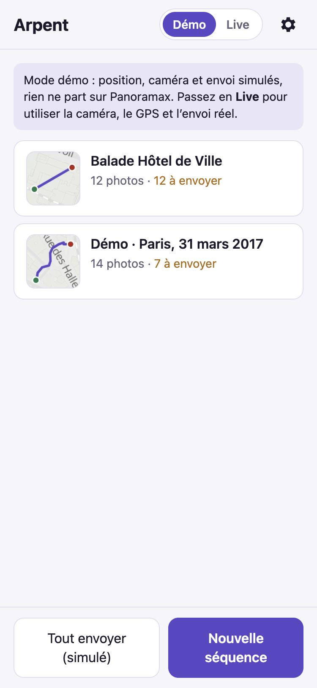
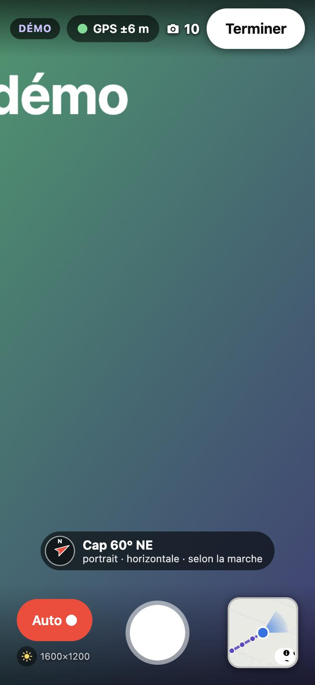
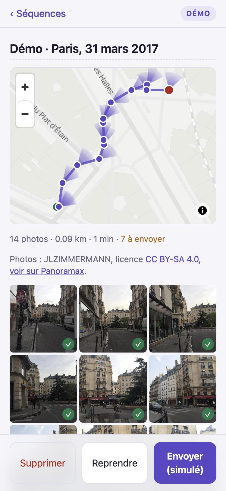
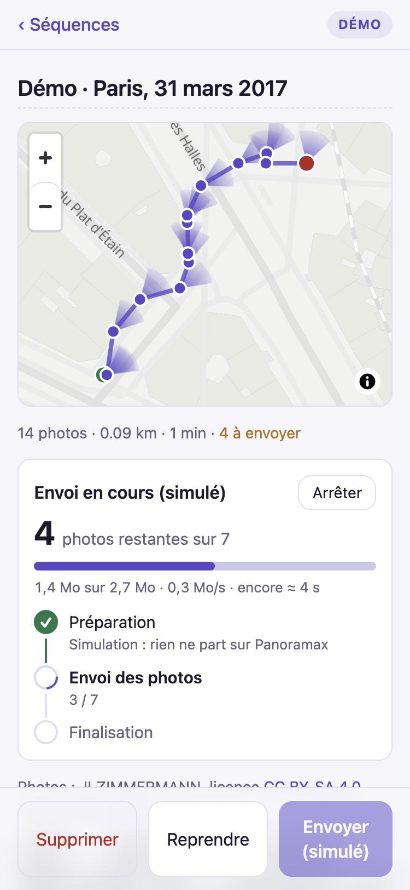
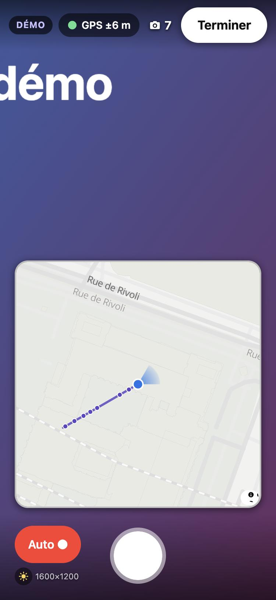
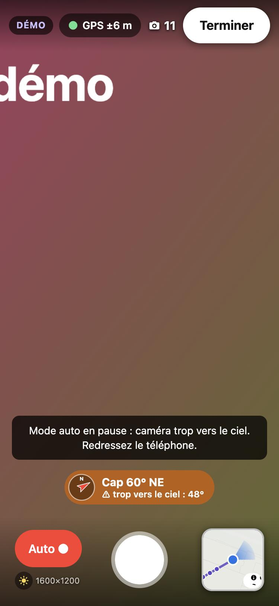
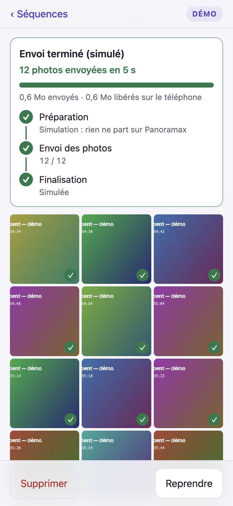
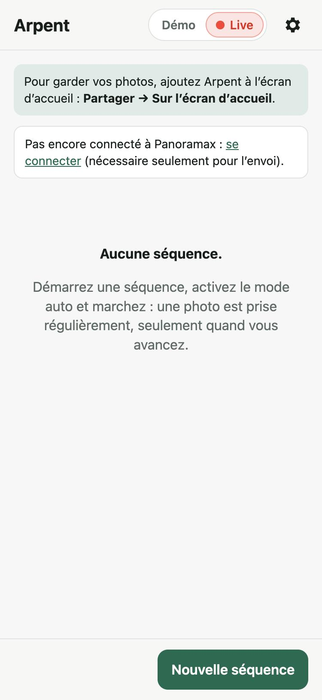
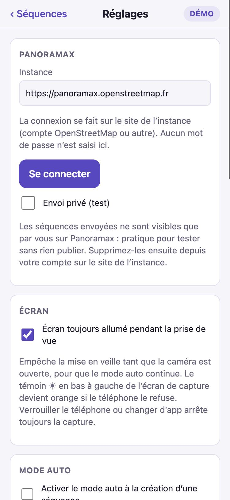
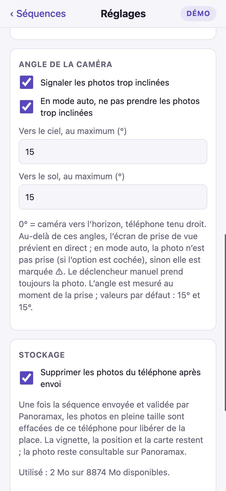

# Arpent

**Capturer des séquences de photos géolocalisées depuis un téléphone et les publier sur [Panoramax](https://panoramax.fr)**, la géo-photothèque libre (photos de rue, comme Street View, mais en commun).

Arpent est une **application web** (PWA) : on ouvre une adresse sur iPhone ou Android, sans rien installer depuis un store. On marche, l'app prend une photo régulièrement, puis on envoie la séquence sur Panoramax.

**👉 Essayer : <https://blamouche.github.io/arpent/>**

L'app s'ouvre en **mode démo** : position, caméra et envoi sont simulés, rien ne part sur Panoramax. L'interrupteur **Démo / Live** en haut de l'écran passe aux vrais capteurs.

<p>
  
  
  
  
</p>

---

## Sommaire

- [Fonctionnalités](#fonctionnalités)
  - [Prise de vue](#prise-de-vue)
  - [Séquences](#séquences)
  - [Envoi sur Panoramax](#envoi-sur-panoramax)
  - [Modes Démo et Live](#modes-démo-et-live)
  - [Réglages](#réglages)
  - [Photos et données](#photos-et-données)
- [Utiliser sur un téléphone](#utiliser-sur-un-téléphone)
- [Tester l'envoi sans rien publier](#tester-lenvoi-sans-rien-publier)
- [Développement](#développement)
- [État du projet](#état-du-projet)
- [Application iOS native](#application-ios-native)
- [Crédits et licence](#crédits-et-licence)

---

## Fonctionnalités

### Prise de vue

<p>
  
  
  
</p>

- **Mode auto** : une photo toutes les *N* secondes, **seulement si l'on s'est déplacé** d'au moins *D* mètres et si le GPS est assez précis. À l'arrêt, rien n'est pris : pas de doublons au feu rouge.
- **Déclencheur manuel**, toujours disponible, avec un flash et une vibration à chaque photo.
- **Mode auto dès la création** (option) : « Nouvelle séquence » ouvre la caméra avec le mode auto déjà en marche.
- **Indicateur de cap** au-dessus du déclencheur :
  - une boussole dont l'aiguille montre la direction de la caméra ;
  - le cap en degrés et en point cardinal (« Cap 60° NE ») ;
  - l'orientation du téléphone (portrait, paysage, à plat) et l'inclinaison de la caméra (« 6° vers le sol »).

  C'est la valeur qui est écrite dans la photo.
- **Cap juste en portrait comme en paysage.** C'est toujours la direction du dos du téléphone, celle de la caméra arrière. Sur iPhone, le cap brut de Safari n'est fiable que téléphone droit en portrait. Arpent s'en sert pour recaler le gyroscope, qui donne ensuite la direction du dos dans toutes les positions, que l'écran tourne ou non. Toucher la pastille de cap affiche les valeurs brutes des capteurs (diagnostic). Sans boussole, l'app utilise la direction de la marche (« selon la marche »).
- **Alerte d'inclinaison.** Si la caméra regarde trop vers le sol (photo de pieds) ou vers le ciel, la pastille devient orange : « ⚠ trop vers le ciel : 48° ».
  - En mode auto, la prise se met en pause tant que le téléphone n'est pas redressé (option).
  - Les seuils se règlent (15° par défaut).
- **Mini-carte** carrée en bas à droite :
  - ta position (point bleu) avec un cône dans la direction de la caméra ;
  - la trace en cours et un point par photo.

  Un toucher l'agrandit, un second la réduit.
- **Écran toujours allumé** pendant la prise de vue (option, activée par défaut) :
  - l'app demande au navigateur de garder l'écran allumé (verrou d'écran) et le redemande s'il est perdu ;
  - si le navigateur refuse, une vidéo noire muette et invisible joue en boucle, ce qui empêche aussi la veille ;
  - un témoin ☀ en bas à gauche passe à l'orange si la mise en veille reste possible.
- **Indicateur GPS** (précision en mètres, pastille verte, orange ou rouge), compteur de photos, grand bouton **Terminer**.

### Séquences

<p>
  
  
</p>

- **Liste des séquences**, chacune avec :
  - une **vignette de carte** de sa trace (départ vert, arrivée rouge) ;
  - le nombre de photos et l'état de l'envoi (« 7 à envoyer », « envoyée ») ;
  - le nombre de photos trop inclinées, s'il y en a.
- **Détail d'une séquence** :
  - un nom modifiable ;
  - la **carte** de la trace sur un fond OpenStreetMap sobre, sans points d'intérêt. Chaque photo est un point avec un cône qui montre sa direction de prise de vue ; toucher un point ouvre la photo ;
  - la distance, la durée et la grille des photos.
- **Visionneuse** : photo en grand avec sa date, la précision GPS, le cap, l'inclinaison et l'état d'envoi. On peut supprimer la photo.
- **Photos trop inclinées** :
  - elles sont marquées ⚠ dans la grille ;
  - un bandeau permet de les **écarter d'un coup** avant l'envoi.
- **Reprendre** une séquence (nouvelles photos à la suite) ou la **supprimer**.

### Envoi sur Panoramax

<p>
  
  
</p>

- **Connexion sans mot de passe dans l'app** :
  - on se connecte sur le site de l'instance (compte OpenStreetMap ou autre) ;
  - Arpent reçoit un jeton dit « réclamé » (*claimable token*) et ne voit jamais le mot de passe.
- **N'importe quelle instance Panoramax.** Par défaut : `panoramax.openstreetmap.fr`.
- **Suivi en direct** :
  - un panneau en trois étapes (préparation, envoi des photos, finalisation), avec une icône par état : fait, en cours, en attente, erreur, arrêté ;
  - le **nombre de photos restantes**, les Mo envoyés, le débit et le temps restant ;
  - sur les vignettes, les photos en attente sont estompées, la photo en cours a un anneau de progression, et une pastille verte apparaît une fois envoyée.
- **Envoi reprenable** :
  - après une coupure réseau ou un **Arrêter**, « Continuer l'envoi » repart de là où il s'est arrêté, sans renvoyer les photos déjà parties ;
  - une finalisation interrompue peut aussi être relancée.
- **Tout envoyer** : les séquences partent l'une après l'autre, les suivantes affichent « En attente ».
- **Lien vers la séquence publiée** sur le site de l'instance. Si Panoramax a découpé la séquence, il y a un lien par morceau.
- **Envoi privé (test)** : les séquences sont visibles par vous seul, pour essayer sans rien publier.
- **Suppression après envoi** (activée par défaut) :
  - une fois la séquence validée par Panoramax, les photos en pleine taille sont effacées du téléphone ; vignette, position et carte restent ;
  - le bilan indique la place libérée.
- L'écran reste allumé pendant l'envoi.

### Modes Démo et Live

<p>
  
  
</p>

| | **Démo** (par défaut) | **Live** |
|---|---|---|
| Thème | violet | vert, avec un point rouge « enregistrement » qui clignote |
| Position | marche simulée, avec des arrêts | GPS du téléphone |
| Caméra | mire animée | caméra arrière |
| Boussole et inclinaison | du téléphone si disponibles, sinon simulées (regards vers les pieds ou le ciel de temps en temps) | du téléphone |
| Envoi | **simulé** (déroulé et débit factices), aucun appel réseau | vers l'instance Panoramax |
| Données | base séparée | base séparée |

En démo, une **séquence d'exemple** est téléchargée au premier lancement depuis Panoramax :
- 14 vraies photos d'iPhone prises à Paris en 2017, avec leurs positions et leurs caps ;
- licence CC BY-SA 4.0 : l'auteur et un lien vers la source sont affichés.

*Réglages → Réinitialiser la démo* la remet à zéro. Le choix du mode est gardé sur l'appareil ; `?demo` ou `?live` dans l'adresse le force.

### Réglages

<p>
  
  
</p>

| Section | Réglage | Par défaut |
|---|---|---|
| Panoramax | Instance | `https://panoramax.openstreetmap.fr` |
| | Envoi privé (test) | non |
| Écran | Écran toujours allumé pendant la prise de vue | oui |
| Mode auto | Activer le mode auto à la création d'une séquence | non |
| | Intervalle | 2 s |
| | Distance minimale | 4 m |
| | Précision GPS maximale | 20 m |
| Angle de la caméra | Signaler les photos trop inclinées | oui |
| | En mode auto, ne pas prendre les photos trop inclinées | oui |
| | Vers le ciel, au maximum | 15° |
| | Vers le sol, au maximum | 15° |
| Stockage | Supprimer les photos du téléphone après envoi | oui |

La section Stockage affiche aussi la place utilisée sur l'appareil.

### Photos et données

- **EXIF complet** écrit dans chaque JPEG, sans recompression : position GPS, altitude, précision, cap, vitesse, date et heure avec millisecondes et fuseau. C'est ce que Panoramax lit pour placer et orienter la photo.
- **Tout reste sur le téléphone** (IndexedDB) jusqu'à l'envoi. Il n'y a pas de serveur Arpent : le téléphone parle directement à l'API Panoramax.
- **Hors ligne** : l'app s'ouvre et capture sans réseau (service worker). Seuls les fonds de carte et l'envoi ont besoin du réseau ; sans réseau, les vignettes montrent la trace seule.

---

## Utiliser sur un téléphone

1. Ouvrir **<https://blamouche.github.io/arpent/>** dans Safari (iPhone) ou Chrome (Android).
2. **Ajouter à l'écran d'accueil.** Sur iPhone : *Partager → Sur l'écran d'accueil*. C'est important : sinon Safari peut effacer les photos après 7 jours sans visite.
3. Passer en **Live**, autoriser la caméra, la position et, sur iPhone, l'orientation (demandée au démarrage d'une séquence).
4. Dans les réglages, **se connecter** à l'instance Panoramax (nécessaire seulement pour l'envoi).

---

## Tester l'envoi sans rien publier

Il n'existe pas d'instance Panoramax publique de test. Pour essayer l'envoi de bout en bout :

1. En **Live**, se connecter à `panoramax.openstreetmap.fr` et cocher **Envoi privé (test)**.
2. Capturer une courte séquence et l'envoyer. Le bouton affiche « Envoyer (privé) » et la séquence devient « envoyée (privée) ».
3. Ouvrir le lien vers la séquence, connecté sur le site, puis la supprimer depuis votre compte.

---

## Développement

HTML, CSS et JavaScript statiques : **pas de build, pas de dépendance à installer, pas de serveur à soi**. L'API Panoramax accepte les appels depuis un navigateur (CORS).

```bash
python3 -m http.server 8137 --directory web
```

Puis ouvrir <http://localhost:8137/>. La caméra et le GPS exigent **HTTPS** sur un téléphone :
- soit publier `web/` sur un hébergement statique ;
- soit passer par un tunnel, par exemple `cloudflared tunnel --url http://localhost:8137`.

**Déploiement** : chaque push sur `main` qui touche `web/` publie le dossier sur GitHub Pages ([workflow](.github/workflows/pages.yml)).

| Fichier (`web/`) | Rôle |
|---|---|
| `index.html`, `style.css` | page unique, 4 écrans (liste, capture, détail, réglages), thèmes clair et sombre |
| `app.js` | écrans, réglages, connexion, envoi et suivi, cartes |
| `sensors.js` | GPS, boussole, cap, inclinaison, caméra, écran allumé, simulations de la démo |
| `panoramax.js` | client de l'API Panoramax (envoi avec progression), client simulé pour la démo |
| `exif.js` | segment EXIF/GPS inséré dans le JPEG sans recompression |
| `db.js` | IndexedDB : séquences, métadonnées des photos, images |
| `demo-data.js` | séquence d'exemple téléchargée depuis Panoramax en mode démo |
| `vendor/maplibre/` | MapLibre GL JS 4.7.1 (cartes), licence BSD-3 incluse |
| `vendor/keep-awake.mp4` | vidéo de secours pour garder l'écran allumé (2 ko) |
| `sw.js`, `manifest.webmanifest`, `icons/` | PWA installable et hors ligne |

Documentation : [PRD](docs/PRD.md), [architecture](docs/ARCHITECTURE.md), [notes sur l'API Panoramax](docs/API-PANORAMAX.md). Détails techniques de la version web : [`web/README.md`](web/README.md).

---

## État du projet

**Prototype.** Ce qui a été vérifié :

- **Mode démo** : capture auto (une photo toutes les ~4 s en marche, aucune à l'arrêt), cartes, alertes d'inclinaison, envoi simulé.
- **EXIF** relu avec Pillow : position, altitude, précision, cap, vitesse, dates avec millisecondes.
- **Calculs d'orientation** sur des poses connues, en portrait et en paysage : cap de la caméra et inclinaison.
- **Envoi contre un faux serveur Panoramax local** :
  - panne au 3e fichier puis reprise sans renvoi ;
  - arrêt en cours d'envoi puis reprise ;
  - *Tout envoyer* avec une file d'attente.
- **CORS** de `panoramax.openstreetmap.fr`.

**Pas encore testé** :
- sur un vrai iPhone ou Android (caméra réelle, boussole, maintien de l'écran) ;
- un envoi réel sur une instance Panoramax.

**Limites connues**

- **Qualité photo** : l'image vient du flux vidéo de la caméra (souvent 1920×1080 à 4K), sans le traitement photo natif du téléphone. La résolution obtenue s'affiche en bas à gauche de la vue caméra.
- **Premier plan** : verrouiller le téléphone ou changer d'app arrête la capture et l'envoi. C'est une limite des pages web.
- **Photo en paysage** : l'image suit l'orientation de l'écran. Pour photographier en paysage, désactiver le verrouillage de rotation (le cap, lui, est juste dans tous les cas).
- **Retour après connexion** : si l'instance refuse la redirection, revenir dans Arpent puis toucher « J'ai terminé, vérifier » dans les réglages.

---

## Application iOS native

Le dossier [`Arpent/`](Arpent/) contient la première version, une application iOS native (SwiftUI, iOS 17+), avec le même principe : mode auto temps + distance, EXIF complet, envoi reprenable, connexion via le site de l'instance. La version web l'a dépassée en fonctionnalités.

1. Ouvrir `Arpent.xcodeproj` avec Xcode 16 ou plus récent.
2. Cible *Arpent* → *Signing & Capabilities* : choisir votre équipe. Un compte Apple gratuit suffit pour son propre iPhone.
3. Lancer sur un iPhone ou un simulateur. Dans le simulateur, *Features → Location → City Run* simule un déplacement.

```bash
xcodebuild -project Arpent.xcodeproj -scheme Arpent -destination 'platform=iOS Simulator,name=iPhone 16' build
```

---

## Crédits et licence

- Cartes : [MapLibre GL JS](https://maplibre.org) (BSD-3), fonds [OpenFreeMap](https://openfreemap.org) © [OpenMapTiles](https://openmaptiles.org), données © [contributeurs OpenStreetMap](https://www.openstreetmap.org/copyright).
- Photos de la démo : JLZIMMERMANN sur [Panoramax](https://panoramax.openstreetmap.fr), CC BY-SA 4.0. Elles sont téléchargées à la demande et ne sont pas copiées dans ce dépôt.
- Arpent s'inspire de [Baba](https://wiki.openstreetmap.org/wiki/Baba) (Android, AGPL-3.0), sans en reprendre le code.

Licence d'Arpent : à définir.
