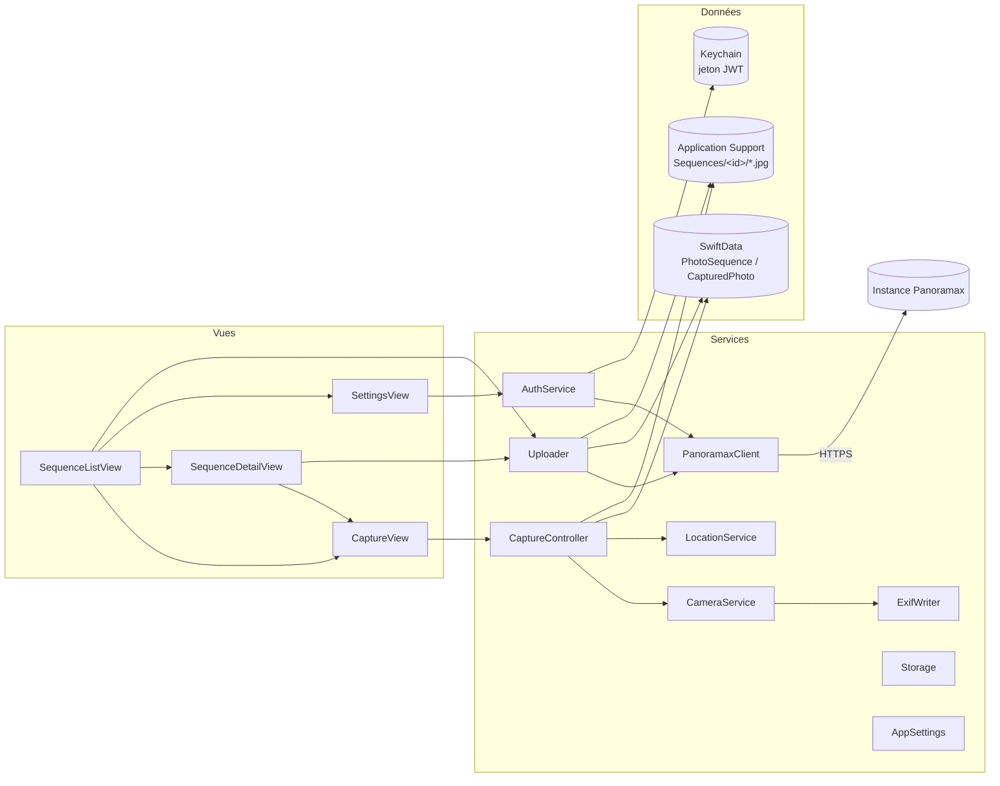
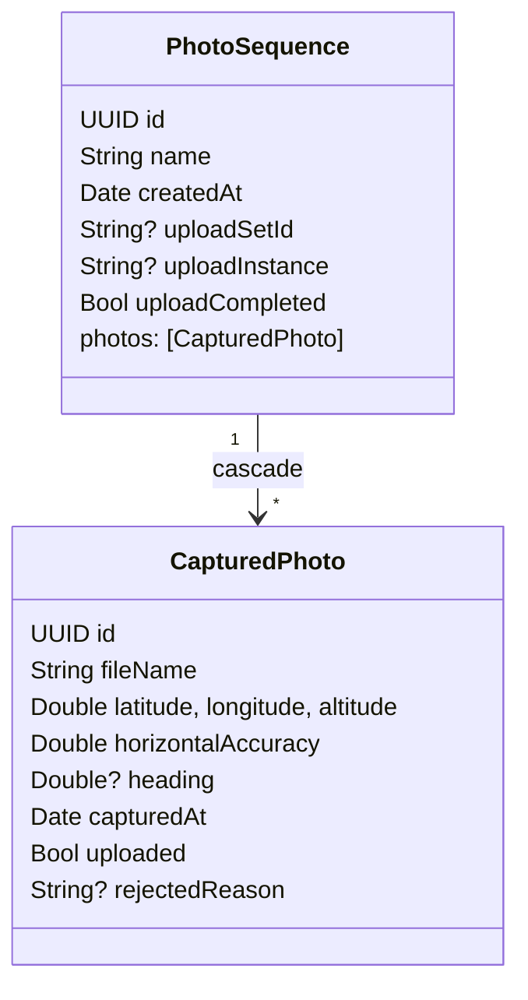
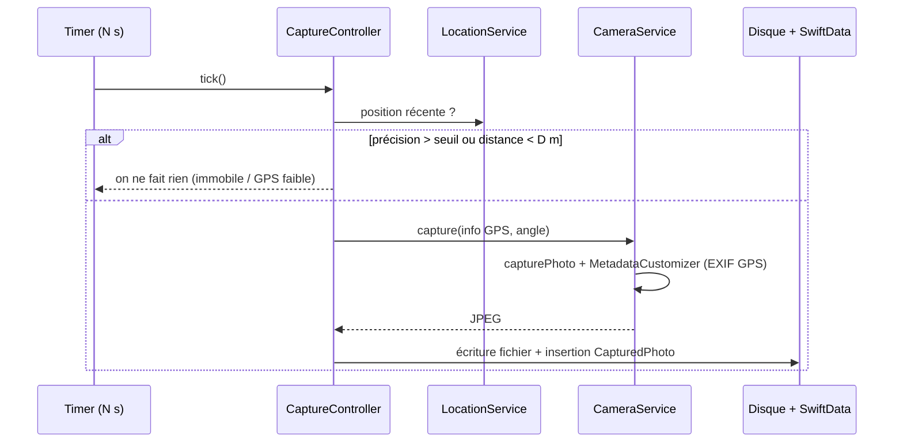
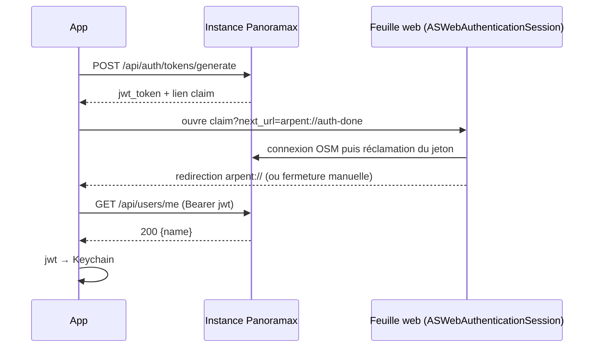

# Architecture — Arpent

## Vue d'ensemble

App SwiftUI mono-cible, iOS 17+, **sans dépendance externe**.

| Brique | Rôle |
|---|---|
| SwiftUI | Interface (4 écrans) |
| SwiftData | Persistance des séquences et des métadonnées des photos |
| AVFoundation | Caméra et injection EXIF sans recompression |
| CoreLocation | GPS et boussole |
| ImageIO | EXIF/GPS et vignettes |
| URLSession | API Panoramax |
| AuthenticationServices | Connexion web |
| Keychain | Stockage du jeton |



## Arborescence

```
Arpent.xcodeproj/          projet Xcode (dossier synchronisé : tout fichier ajouté sous Arpent/ est compilé)
Arpent/
  ArpentApp.swift          point d'entrée, ModelContainer, injection AuthService / Uploader
  Models/
    PhotoSequence.swift    séquence (= upload set Panoramax)
    CapturedPhoto.swift    photo : fichier, position, cap, date, statut d'envoi
  Services/
    AppSettings.swift      réglages (UserDefaults / @AppStorage)
    Storage.swift          fichiers JPEG sur disque, suppression
    LocationService.swift  CLLocationManager (position + cap)
    CameraService.swift    AVCaptureSession, prise de vue, repli simulateur
    ExifWriter.swift       dictionnaires EXIF/GPS (ImageIO)
    CaptureController.swift règle temps + distance, enregistrement des photos
    PanoramaxClient.swift  appels HTTP Panoramax
    AuthService.swift      connexion par jeton réclamé + Keychain
    Uploader.swift         envoi reprenable des séquences
  Views/
    SequenceListView.swift accueil
    CaptureView.swift      prise de vue + CameraPreview
    SequenceDetailView.swift carte, vignettes, envoi
    SettingsView.swift     instance, compte, réglages de capture
docs/                      PRD, architecture, notes API
```

## Modèle de données



- **Les JPEG sont sur disque** (`Application Support/Sequences/<id séquence>/IMG_yyyyMMdd_HHmmss_SSS.jpg`). La base ne contient que les métadonnées, ce qui garde SwiftData léger.
- Les noms de fichiers sont horodatés à la milliseconde, donc uniques dans un upload set (exigence Panoramax).
- La suppression d'une séquence efface son dossier puis l'objet (cascade sur les photos).

## Capture



Points clés :
- **Règle temps + distance** (`CaptureController.tick`) : le timer cadence les vérifications, la distance (`CLLocation.distance(from:)`) décide de la prise. À l'arrêt, aucune photo n'est prise.
- **Position utilisable** : précision ≤ seuil et date de moins de 10 s.
- **EXIF sans recompression** : `AVCapturePhoto.fileDataRepresentation(with:)` et un `AVCapturePhotoFileDataRepresentationCustomizer` remplacent les métadonnées (GPS + `DateTimeOriginal` / `SubsecTimeOriginal` / `OffsetTimeOriginal`).
- **Cap** : boussole (`trueHeading`, alignée sur l'orientation physique du téléphone), sinon direction du déplacement (`course`).
- **Orientation** : `videoRotationAngle` est réglé à chaque prise selon `UIDevice.orientation`. L'UI reste en portrait.
- **Simulateur** : sans caméra, une image de test est générée et taguée via `ExifWriter.write`, ce qui permet de tester tout le flux avec une localisation simulée.

## Authentification



- Aucun mot de passe ne transite par l'app.
- Le jeton est lié à l'instance : changer d'URL déconnecte.

## Envoi

`Uploader.upload(sequence)` :
1. Crée un upload set (`POST /api/upload_sets`, `sort_method=time-asc`) s'il n'y en a pas, si l'instance a changé, ou si le précédent est déjà complété.
2. Envoie les photos non envoyées une par une (`POST …/files`, multipart `file`). Chaque succès (202, ou 409 pour un doublon) passe `uploaded = true` et est sauvegardé immédiatement, d'où la **reprise**.
3. `POST …/complete`, puis `uploadCompleted = true`.
4. Si l'upload set a disparu côté serveur (404), un nouveau est créé et l'envoi recommence une fois.
5. En option, les JPEG envoyés sont supprimés du disque ; l'historique est conservé.

## Concurrence

- `CaptureController`, `AuthService` et `Uploader` sont `@MainActor @Observable`.
- `CameraService` sérialise tout l'accès AVFoundation sur une file dédiée (`arpent.camera`). Les captures en attente sont associées à leur `uniqueID`.
- `LocationService` est créé sur le thread principal, donc ses callbacks y arrivent aussi.
- Swift 5 language mode : pas de concurrence stricte, pour garder le code court.

## Choix et alternatives écartées

| Choix | Pourquoi | Écarté |
|---|---|---|
| SwiftUI + SwiftData | Moins de code ; iOS 17 couvre l'essentiel du parc | Core Data, fichiers JSON |
| Upload sets (API récente) | Flux recommandé ; dédoublonnage et découpage côté serveur | `POST /collections/{id}/items` (ancien flux) |
| Jeton réclamé | Pas de client OAuth à enregistrer auprès de chaque instance | OAuth natif, saisie manuelle d'un jeton |
| Upload au premier plan | Simplicité ; reprise suffisante | `URLSession` background (v2) |
| Projet Xcode à dossier synchronisé | `project.pbxproj` minimal, pas de générateur | XcodeGen, Tuist, SwiftPM app |
