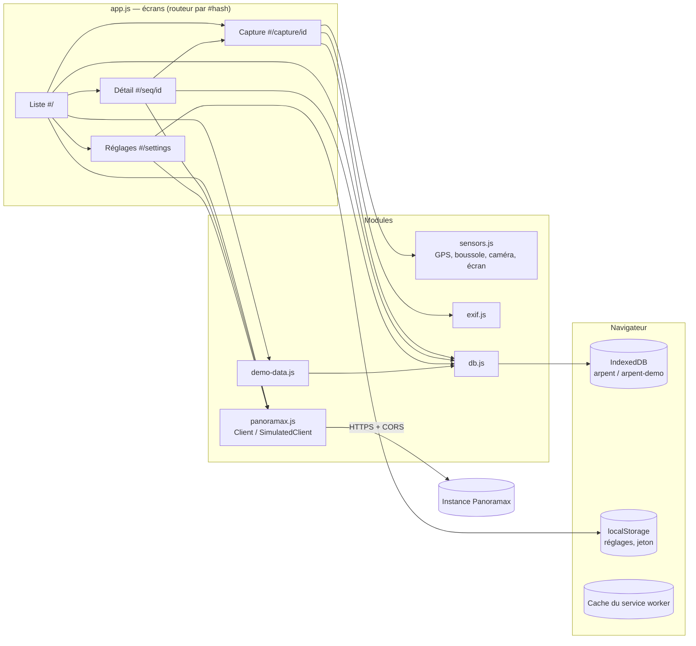
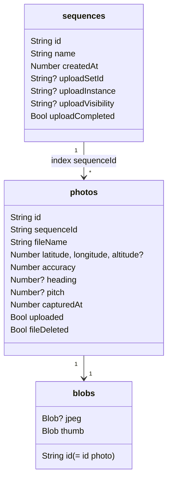
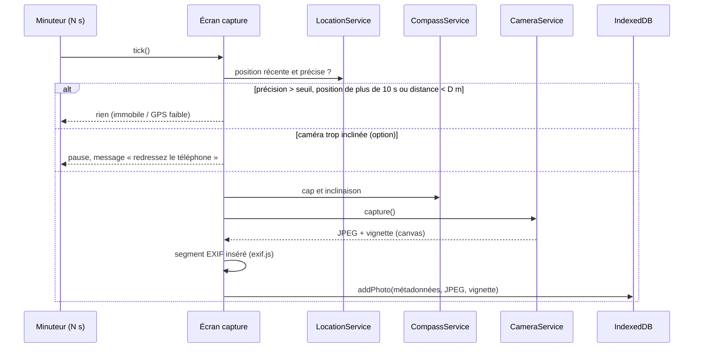
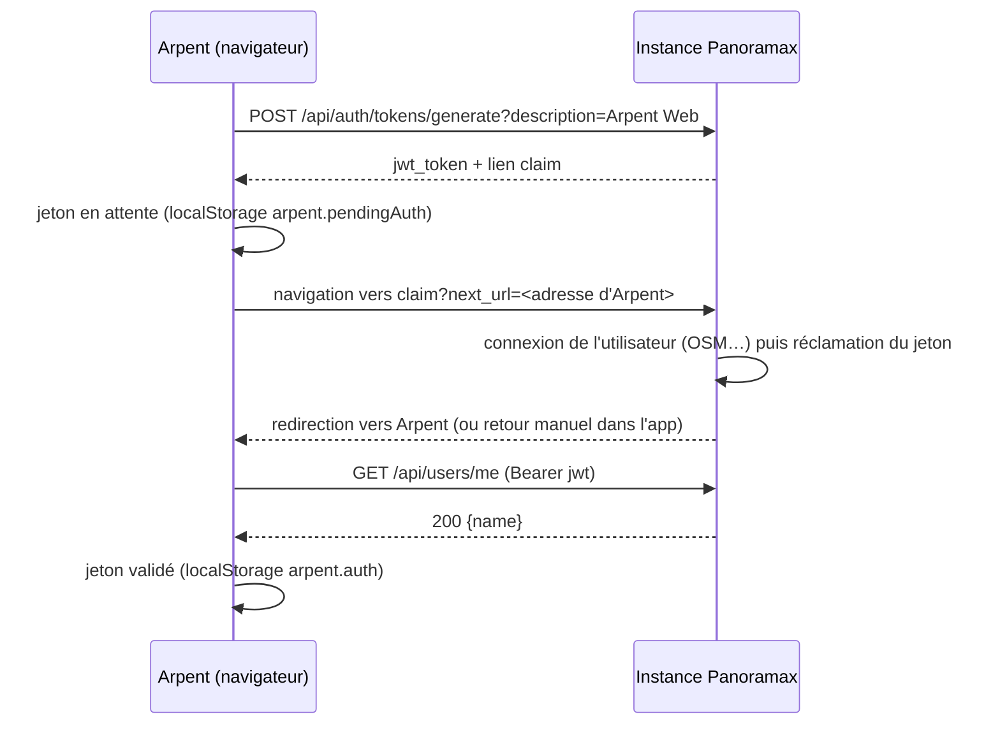

# Architecture — Arpent

## Vue d'ensemble

Application web progressive (PWA) : HTML, CSS et JavaScript statiques en modules ES, **sans build, sans dépendance à installer, sans serveur à soi**. Le téléphone parle directement à l'API Panoramax (CORS). Seule bibliothèque embarquée : MapLibre GL JS pour les cartes.

| Brique | Rôle |
|---|---|
| `getUserMedia` + canvas | Caméra arrière, photo tirée du flux vidéo en JPEG |
| Geolocation API | Position GPS, vitesse, direction de marche |
| `deviceorientation(absolute)` | Cap de la caméra et inclinaison |
| Wake Lock API (+ vidéo de secours) | Écran allumé pendant la prise de vue et l'envoi |
| IndexedDB | Séquences, métadonnées des photos, JPEG et vignettes |
| `localStorage` | Réglages, jeton Panoramax, cache des vignettes de carte |
| `XMLHttpRequest` | Envoi des photos avec progression |
| Service worker + manifeste | Installation sur l'écran d'accueil, fonctionnement hors ligne |
| MapLibre GL JS 4.7.1 | Cartes (fonds OpenFreeMap) |



## Arborescence

```
web/                       publié tel quel sur GitHub Pages
  index.html, style.css    page unique, 4 écrans, thèmes clair et sombre
  app.js                   routeur, écrans, réglages, connexion, envoi et suivi, cartes
  sensors.js               mode Démo/Live, GPS, boussole et cap, inclinaison, caméra, écran allumé
  panoramax.js             client de l'API Panoramax, client simulé pour la démo
  exif.js                  segment EXIF/GPS inséré dans le JPEG sans recompression
  db.js                    IndexedDB : séquences, photos, images
  demo-data.js             séquence d'exemple téléchargée depuis Panoramax
  sw.js                    service worker (réseau d'abord, cache en secours)
  manifest.webmanifest, icons/
  vendor/maplibre/         MapLibre GL JS + licence
  vendor/keep-awake.mp4    vidéo de secours pour garder l'écran allumé
  README.md                notes techniques détaillées
docs/                      PRD, architecture, notes API, captures d'écran
.github/workflows/pages.yml  déploiement de web/ sur GitHub Pages
```

## Modèle de données



- **Deux bases** : `arpent` (Live) et `arpent-demo` (Démo), pour que la démo ne touche jamais aux vraies photos.
- **Images à part** : le magasin `photos` ne contient que des métadonnées légères ; JPEG et vignette sont dans `blobs` et ne sont lus qu'à la demande.
- Les noms de fichiers sont horodatés à la milliseconde, donc uniques dans un upload set (exigence Panoramax).
- « Supprimer après envoi » efface le JPEG (`fileDeleted = true`) et garde la vignette, la position et le cap.

## Capture



Points clés :
- **Règle temps + distance** : le minuteur cadence les vérifications, la distance depuis la dernière photo décide de la prise. À l'arrêt, aucune photo.
- **EXIF sans recompression** : un segment APP1 « Exif » est construit à la main et inséré dans le JPEG produit par le canvas.
- **Cap** : direction du dos du téléphone (caméra arrière), en portrait comme en paysage ; sur iPhone, gyroscope recalé sur la boussole téléphone droit en portrait ; calage optionnel sur la direction de marche ; sinon direction GPS du déplacement. Le détail est dans [`web/README.md`](../web/README.md).
- **Inclinaison** enregistrée avec chaque photo ; les alertes sont recalculées à l'affichage selon les seuils du moment.

## Authentification



- Aucun mot de passe ne transite par l'app.
- Le jeton est vérifié au retour dans l'app (`visibilitychange`) ou avec « J'ai terminé, vérifier » si l'instance refuse la redirection.
- Le jeton est lié à l'instance : changer d'URL déconnecte.

## Envoi

`uploadSequence(id)` dans `app.js` :
1. Crée un upload set (`POST /api/upload_sets`, `sort_method=time-asc`, `visibility=owner-only` en envoi privé) s'il n'y en a pas, si l'instance ou la visibilité a changé, ou si le précédent est terminé.
2. Envoie les photos non envoyées une par une (`POST …/files`, multipart `file`) avec progression. Chaque succès (202, ou 409 pour un doublon) passe `uploaded = true` et est enregistré aussitôt, d'où la **reprise** sans renvoi.
3. `POST …/complete`, puis `uploadCompleted = true`. Une finalisation interrompue est relancée seule au prochain envoi.
4. Si l'upload set a disparu côté serveur (404), un nouveau est créé et l'envoi recommence une fois.
5. Selon le réglage, les JPEG envoyés sont effacés de l'appareil.
6. Le lien vers la séquence publiée est lu dans `GET /api/upload_sets/{id}` → `associated_collections`.

« Tout envoyer » enchaîne les séquences l'une après l'autre ; un **Arrêter** annule la requête en cours (`AbortController`). En démo, `SimulatedClient` remplace le client réel : même déroulé, aucun appel réseau.

## Déploiement

Chaque push sur `main` qui touche `web/` publie le dossier sur GitHub Pages ([workflow](../.github/workflows/pages.yml)). Le service worker passe par le réseau d'abord : un téléphone récupère la nouvelle version dès qu'il est en ligne.

**Publier une version** : changer `?v=NN` dans le bloc dédié de [index.html](../web/index.html) (feuille de style, import map, `app.js`), et nulle part ailleurs. `app.js` lit la version dans sa propre URL (affichage, tag `created_by`, EXIF `Software`) et enregistre `sw.js?v=NN`, qui en tire le nom de son cache (`arpent-vNN`). La version dans l'URL de chaque module empêche les caches du navigateur de mêler deux versions : ils peuvent servir un module importé sans passer par le service worker, et un `app.js` neuf avec un `exif.js` ancien bloquait le chargement. `index.html` lui-même est revalidé à chaque ouverture (`cache: 'no-cache'` dans le service worker).

## Choix et alternatives écartées

| Choix | Pourquoi | Écarté |
|---|---|---|
| PWA statique | Une seule base de code pour iPhone et Android, rien à installer depuis un store, hébergement gratuit | Application iOS native (SwiftUI, abandonnée), app Android |
| Aucun build, modules ES | Rien à installer pour développer ; le code publié est le code source | Bundler, framework |
| Pas de serveur Arpent | L'API Panoramax accepte les appels du navigateur (CORS) ; les données ne passent par personne d'autre | Proxy d'envoi |
| Upload sets (API récente) | Flux recommandé ; dédoublonnage et découpage côté serveur | `POST /collections/{id}/items` (ancien flux) |
| Jeton réclamé | Pas de client OAuth à enregistrer auprès de chaque instance | OAuth, saisie manuelle d'un jeton |
| Photo tirée du flux vidéo | Seul accès caméra continu et sans interaction dans un navigateur | `<input type="file" capture>` (une interaction par photo) |
| Envoi au premier plan | Une page web ne peut pas envoyer écran éteint ; la reprise suffit | Background Sync (support partiel) |
